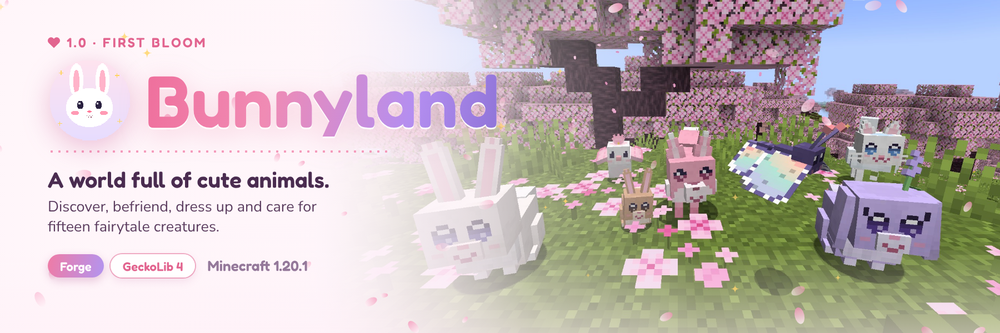

## A world full of cute animals.

**Bunnyland** fills Minecraft's meadows, flower forests, cherry groves, snowy biomes, forests and rivers with **fifteen fairytale creatures**. Find them in the wild, win them over with their favourite treats, dress them up in hats and bows, and keep them happy with pet beds, feeding bowls and toys. Breed them for **rare variants** that sparkle and glow in the dark, and fill a **Pet Journal** with every creature you meet.

Every creature has its own 3D GeckoLib model, a painted texture with a blinking face, idle, walk, run, sit, sleep, eat, happy, play and signature animations, original sounds and its own behaviour.

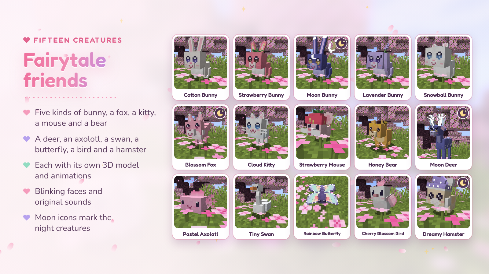

| Creature | Lives in | Befriend with | Special behaviour |
| --- | --- | --- | --- |
| **Cotton Bunny** | Meadows, flower forests, plains, cherry groves | Bunny Biscuit | Sheds **Cotton Fluff** every few minutes; lands softly |
| **Strawberry Bunny** | Flower forests, meadows, sunflower plains, birch forests | Strawberry Tart | Hops over to ripe sweet berry bushes and nibbles them |
| **Moon Bunny** | Meadows, groves, snowy slopes, snowy plains | Moon Cookie | Night creature with glowing markings and a floating crescent moon; jumps high, never takes fall damage, walks on powder snow |
| **Lavender Bunny** | Flower forests, meadows, cherry groves | Bunny Biscuit | Lop-eared and sniffs flowers; petting a happy one gives you **Regeneration** for 5 seconds |
| **Snowball Bunny** | Snowy plains, snowy taigas, ice spikes, groves, snowy slopes | Bunny Biscuit | Can't freeze, walks on powder snow, kicks up snowflakes |
| **Blossom Fox** | Cherry groves, flower forests, birch forests | Blossom Mochi | Night creature; sheds cherry petals as it runs; spins and pounces |
| **Cloud Kitty** | Meadows, cherry groves, plains, windswept hills | Fish Cracker | Floats down instead of falling; purrs; **leaves a gift** when you wake up nearby |
| **Strawberry Mouse** | Plains, meadows, flower forests, forests | Strawberry Tart | Tiny and quick; wild ones flee from cats and Cloud Kitties |
| **Honey Bear** | Forests, birch forests, flower forests | Honey Cake | Sturdy (20 health); licks full beehives clean; a bee buddy orbits its head; stands up for hugs |
| **Moon Deer** | Taigas, groves, forests, meadows | Moon Cookie | Night creature with glowing antlers and starry spots; steps up full blocks; very shy |
| **Pastel Axolotl** | Rivers, swamps | Fish Cracker | Swims and walks; never dries out |
| **Tiny Swan** | Rivers, swamps | Seed Medley | Floats and paddles; cygnets follow their parents; heart-wing display |
| **Rainbow Butterfly** | Flower forests, meadows, cherry groves, plains | Flower Nectar | Flies from flower to flower and rests on them; sometimes **plants a new flower** |
| **Cherry Blossom Bird** | Cherry groves, flower forests | Blossom Mochi | Flies and perches; sings in the daytime; **dances** next to a playing jukebox |
| **Dreamy Hamster** | Plains, sunflower plains, meadows, savannas | Seed Medley | Night owl in a starry nightcap; stuffs its cheeks when it eats; blows dream bubbles while asleep |

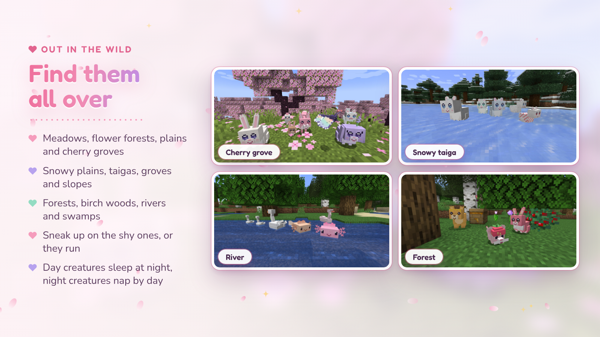

- **Day creatures sleep at night, and night creatures nap through the day.** You'll find them curled up with their eyes closed and little Zzz's floating up.
- Wild bunnies, mice, foxes and deer are **shy**: they run from players who aren't sneaking. **Sneak** to get close. A sleeping wild creature wakes up if you walk right up to it without sneaking.
- Rainbow Butterflies are out in the daytime, among the flowers.
- Any creature you can see within 16 blocks is written into your **Pet Journal**.

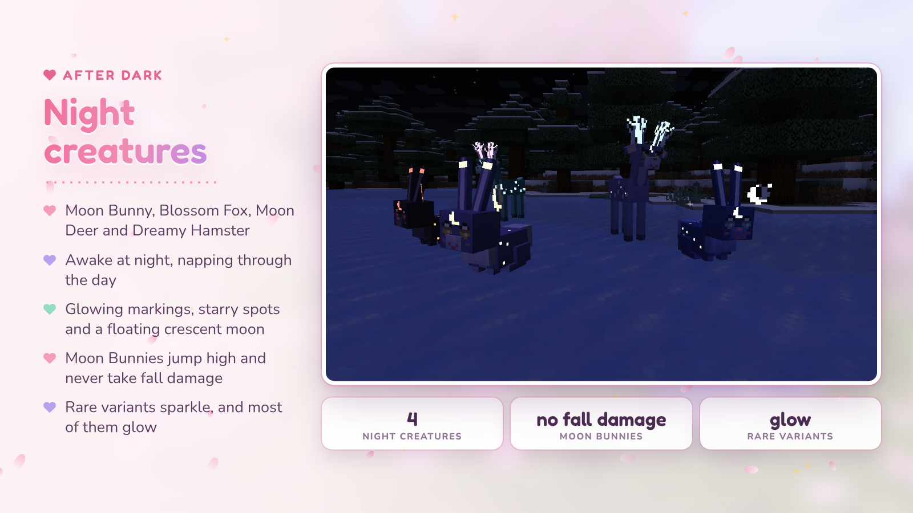

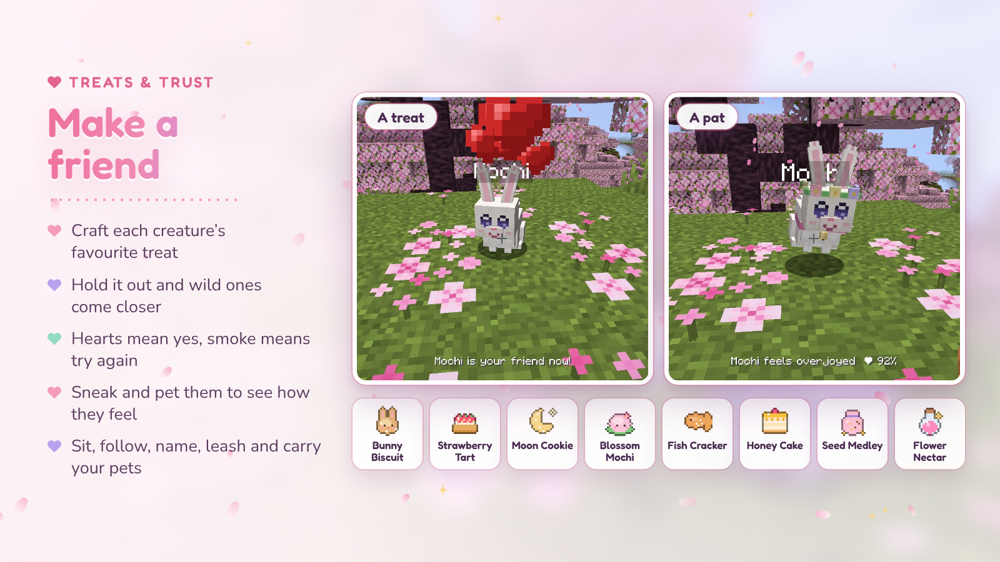

1. Craft the creature's favourite treat. Its tooltip says which creatures it tames.
2. Hold the treat: wild creatures are tempted by it and come closer.
3. Use the treat on the creature. Each treat has a chance to work, from 1 in 2 for butterflies and hamsters to 1 in 5 for the shy Moon Deer. Hearts mean success, smoke means "try again".

The wrong treat never works: a Bunny Biscuit won't tame a Honey Bear.

| Do this | What happens |
| --- | --- |
| Use with an **empty hand** | Toggle **sit / follow**. A sitting pet waits where it is |
| **Sneak** and use with an empty hand | **Pet** it: a happy animation and sound, hearts, more happiness, and its mood |
| Use a **Name Tag** or a **Lead** | Name it, or leash it |
| Use its **food or a treat** | Feed it: it heals, cheers up, and babies grow up faster |
| Use **Shears** | Takes off one cosmetic at a time (accessory, then bow, then collar) and gives it back |
| Use the **Pet Journal** | Shows its species, variant and happiness |
| Use a **Pet Carrier** | Picks it up with its name, variant, happiness and outfit. Use the carrier on a block to let it out |

Following pets teleport to you when left far behind. Like vanilla wolves and cats, pets sit and wait while their owner is offline.

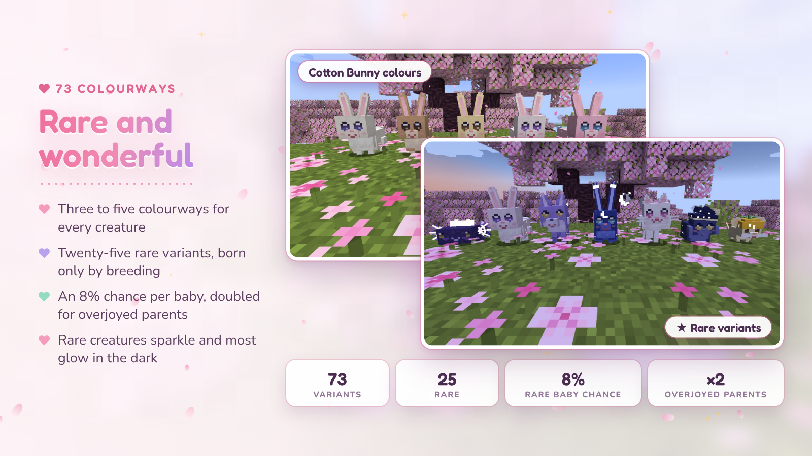

Every creature comes in three to five common colourways and one or two **rare variants**: **73** in all, **25** of them rare. Sugar Star, Cotton Candy, Eclipse, Starlight, Golden Berry, Wisteria, Aurora, Twilight Blossom, Golden Hour, Storm, Rainbow, Royal Jelly, Midnight Honey, Solar, Opal, Galaxy, Midnight, Golden, Prism, Golden Sakura and Starry Night never spawn in the wild by default.

- Feed two adults of the same kind their **breeding food** (or their taming treat) while they are healthy.
- Tamed pets need at least **40% happiness** to breed. A lonely pet tells you it isn't in the mood.
- Babies take after a parent's colour, or are born **rare**: an **8%** chance, doubled when both parents are overjoyed.
- Babies belong to the parents' owner and grow up faster when fed. Swan cygnets follow their parents in a line.
- Rare creatures sparkle, and most of them glow in the dark.

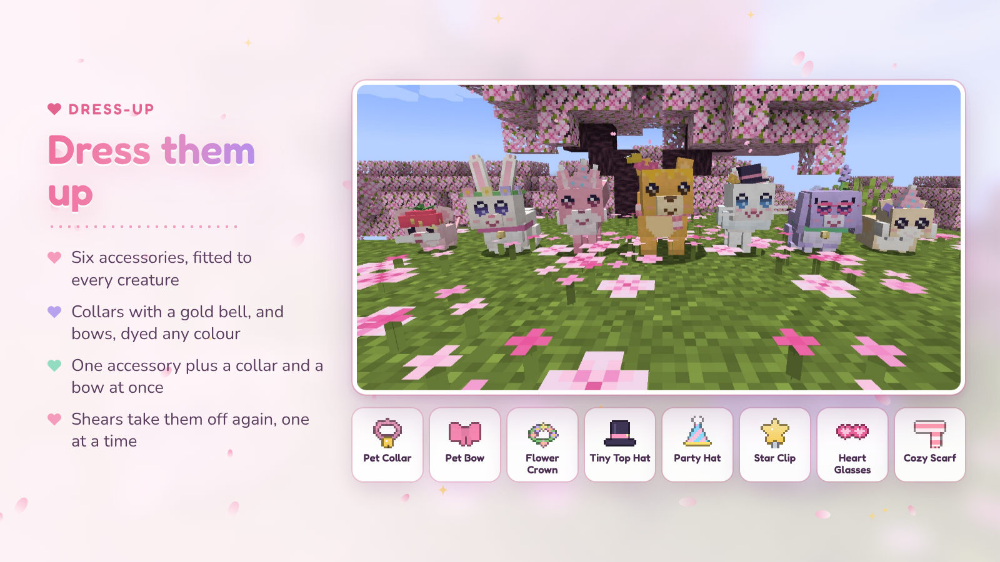

Use a cosmetic on **your own** pet. Every creature has its own fitted version of each one.

- **Pet Collar** with a little gold bell, and **Pet Bow**. Both can be **dyed any colour** in a crafting grid, like leather armour. Swapping one gives the old one back with its colour.
- One **accessory** at a time: **Flower Crown**, **Tiny Top Hat**, **Party Hat**, **Star Clip**, **Heart Glasses** or **Cozy Scarf**. Hats replace the Dreamy Hamster's nightcap while worn.
- Shears take them off again, one at a time.

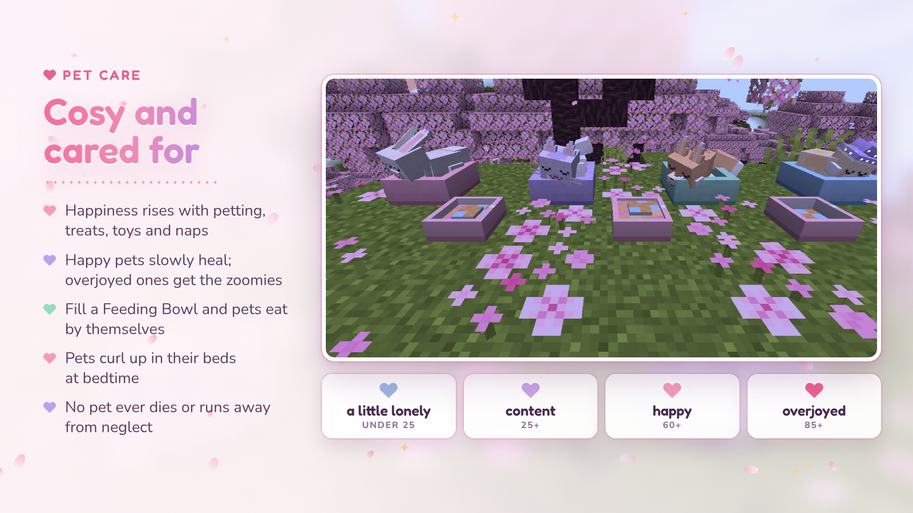

Care is light. **No pet ever dies or runs away from neglect.**

- **Happiness (0 – 100%)** goes up when you pet it (once every 30 seconds), feed it, play with it, dress it up, and when it eats from a bowl or sleeps in a pet bed. It drops slowly over time (one point every 3 minutes, never below 10) and when the pet gets hurt.
- **Moods:** *a little lonely* (under 25, little rain drops), *content*, *happy* (60+) and *overjoyed* (85+, floating hearts and the occasional **zoomies**). Happy and overjoyed pets slowly regenerate health.
- **Feeding Bowl:** fill it with Pet Kibble or any treat, up to 8 portions. A tamed pet that is hurt or a little sad walks over by itself and eats. Comparators read how full it is.
- **Pet Beds** in pink, lavender, mint and sky: at bedtime, a tamed pet that isn't sitting finds a free bed within 12 blocks and curls up in it. Pets also fall asleep wherever they are when **you** go to sleep nearby.
- **Toys:** use one on your pet, or in the air to play with every pet of yours within 8 blocks. A favourite toy cheers a pet up almost twice as much (+18 instead of +10). Toys last 64 uses, and a pet needs a 10-second rest between games.

| Toy | Favourite of |
| --- | --- |
| **Yarn Ball** | Cloud Kitties, Blossom Foxes and Honey Bears |
| **Squeaky Carrot** | Bunnies, mice and hamsters |
| **Feather Wand** | Kitties, birds, butterflies, swans, deer and axolotls. Pets follow it like a treat |

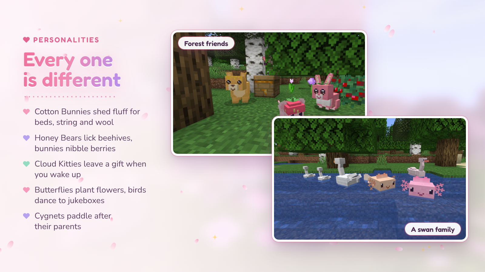

- **Cotton Bunnies** shed Cotton Fluff: stuffing for pet beds, two make String and four make White Wool.
- **Honey Bears** lick full beehives and bee nests clean, and **Strawberry Bunnies** nibble ripe sweet berry bushes. Both respect the `mobGriefing` game rule and can be turned off.
- **Cloud Kitties** leave a little gift (string, a feather, petals, berries, flowers, and very rarely a phantom membrane) when you wake up nearby.
- **Rainbow Butterflies** rest on flowers and sometimes plant a matching one next to it.
- **Cherry Blossom Birds** sing in the daytime and dance next to a playing jukebox.
- **Tiny Swan** cygnets paddle after their parents in a line.

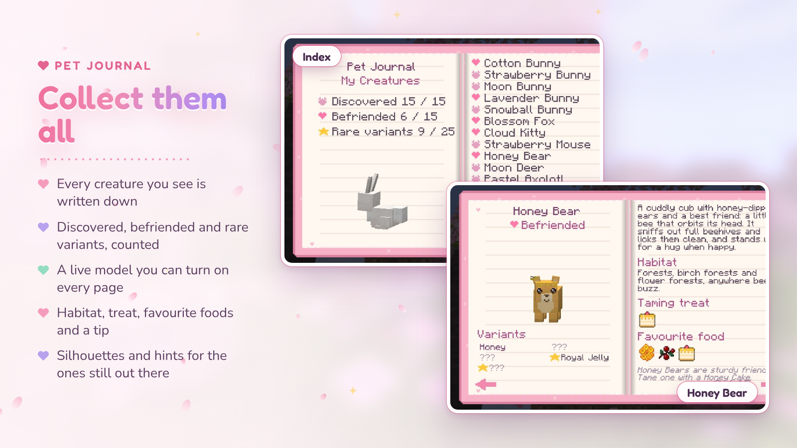

Every player gets a **Pet Journal** on their first join, and one is easy to craft.

- **Index:** how many creatures you've discovered and befriended, and how many rare variants you've seen. Click a name to jump to its page.
- **Creature pages:** a live animated model (drag to turn it), its variants (rare ones starred; click one you've seen to preview it), a description, its habitat, taming treat and favourite foods, and a tip.
- Creatures you haven't found yet appear as silhouettes with a hint about where to look.
- Toasts pop up when you discover a creature, befriend a new kind, or find a rare variant.

| Item | Recipe |
| --- | --- |
| Bunny Biscuit ×4 | Carrot, wheat and sugar |
| Strawberry Tart ×3 | 2 sweet berries, wheat, sugar and an egg |
| Moon Cookie ×4 | Glow berries, wheat and sugar |
| Blossom Mochi ×4 | Pink petals, wheat and sugar |
| Fish Cracker ×4 | Any fish and wheat |
| Honey Cake ×2 | A honey bottle, wheat, sugar and an egg |
| Seed Medley ×2 | Wheat seeds and 2 other seeds |
| Flower Nectar ×2 | A honey bottle and 2 small flowers |
| Pet Kibble ×6 | 2 wheat and a carrot, potato, beetroot, apple, sweet berries or melon slice |
| Pet Collar | String, leather and string over a gold nugget |
| Pet Bow ×2 | Any wool and string |
| Flower Crown | Five small flowers in a ring |
| Tiny Top Hat | Black wool around pink dye |
| Party Hat | String over paper, pink dye and paper |
| Star Clip ×2 | Gold nuggets around glowstone dust, over an iron nugget |
| Heart Glasses | Two pink stained glass panes and an iron nugget |
| Cozy Scarf | Four wool |
| Yarn Ball | Any wool and 2 string |
| Squeaky Carrot | A carrot and a slime ball |
| Feather Wand | A feather on two sticks |
| Pet Carrier | Leather over planks and iron bars |
| Pet Journal | A book, a feather and a small flower |
| Feeding Bowl | Three terracotta |
| Pet Bed (pink, lavender, mint, sky) | Matching wool, stuffing (Cotton Fluff, a feather or white wool) and wooden slabs |
| String | 2 Cotton Fluff |
| White Wool | 4 Cotton Fluff |

The treats are snacks for you too.

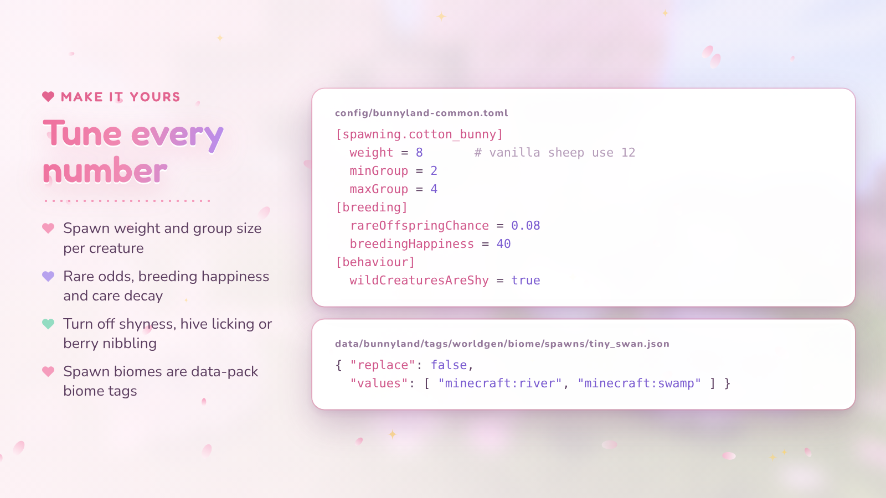

`config/bunnyland-common.toml` holds the server rules:

- **spawning:** a global `spawnWeightMultiplier`, and for every creature `enabled`, `weight`, `minGroup` and `maxGroup`.
- **breeding:** `rareOffspringChance` (0.08), `naturalRareChance` (0, so rare variants only come from breeding) and `breedingHappiness` (40).
- **care:** `happinessDecay`, `happinessDecayMinutes` (3) and `petsTeleport`.
- **behaviour:** `wildCreaturesAreShy`, `cottonFluffMinutes`, `butterfliesSpreadFlowers`, `honeyBearsLickHives` and `berryBunniesEatBerries`.
- **journal:** `discoveryRange` (16) and `starterJournal`.

`config/bunnyland-client.toml` turns the ambient particles and the journal toasts on or off.

Spawn biomes come from the biome tags `bunnyland:spawns/<creature>`, and treats and foods from the item tags `bunnyland:taming_treats/<creature>` and `bunnyland:breeding_food/<creature>`, so data packs can move creatures into modded biomes or change what they eat.

- **Six advancements:** *Bunnyland*, *A Furry Friend* (befriend anything), *A Whole Fluffle* (all five bunnies), *Best Friends Forever* (all fifteen), *Once in a Blue Moon* (breed a rare variant) and *Snug as a Bunny* (place a pet bed).
- **Spawn eggs** for every creature in the **Bunnyland** creative tab.
- **Commands:** `/summon bunnyland:moon_bunny ~ ~ ~ {Variant:4}` or `/summon bunnyland:honey_bear ~ ~ ~ {Accessory:"party_hat",CollarColor:16748491}`. Useful NBT: `Variant`, `Happiness`, `CollarColor`, `BowColor`, `Accessory` and `Napping`.
- **Original sounds** for every creature, the Squeaky Carrot, the Feeding Bowl, the Pet Carrier and the collar bell.

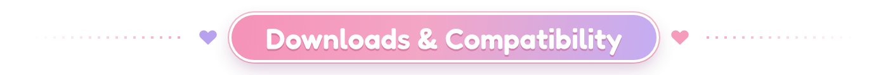

| Minecraft | Loader | Java | Also install |
| --- | --- | --- | --- |
| 1.20.1 | Forge 47.1 or newer | 17+ | [GeckoLib 4](https://www.curseforge.com/minecraft/mc-mods/geckolib) (4.4.9 or newer) |

- Install Bunnyland and GeckoLib on **both the server and every client**.
- Bunnyland is a mod. It does not work as a Paper, Spigot or Folia plugin.

**Do I need GeckoLib?**
Yes. Bunnyland's models and animations run on GeckoLib 4 for Forge 1.20.1, version 4.4.9 or newer.

**Can my pet die or run away if I forget about it?**
No. Happiness never drops below 10, and pets never leave. A lonely pet just won't breed until you give it some love.

**Can I find rare variants in the wild?**
Not by default: rare variants are born only by breeding. Set `naturalRareChance` above 0 in `bunnyland-common.toml` to let some spawn naturally.

**Does it change vanilla animals?**
No. Bunnyland adds its own creatures next to vanilla's and leaves vanilla animals alone.

**Will Honey Bears and Strawberry Bunnies wreck my farm?**
They only empty full beehives and eat ripe berries, both respect the `mobGriefing` game rule, and both can be turned off in the config.

**Can creatures spawn in modded biomes?**
Yes, with a data pack: add the biome to the `bunnyland:spawns/<creature>` biome tag.

**Is there a Fabric or NeoForge version?**
Bunnyland is for Forge 1.20.1.

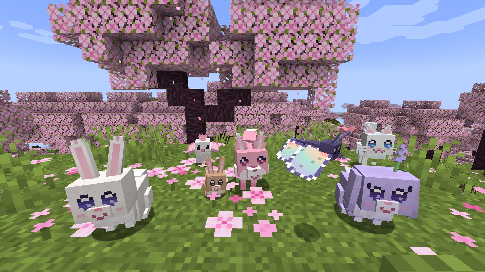

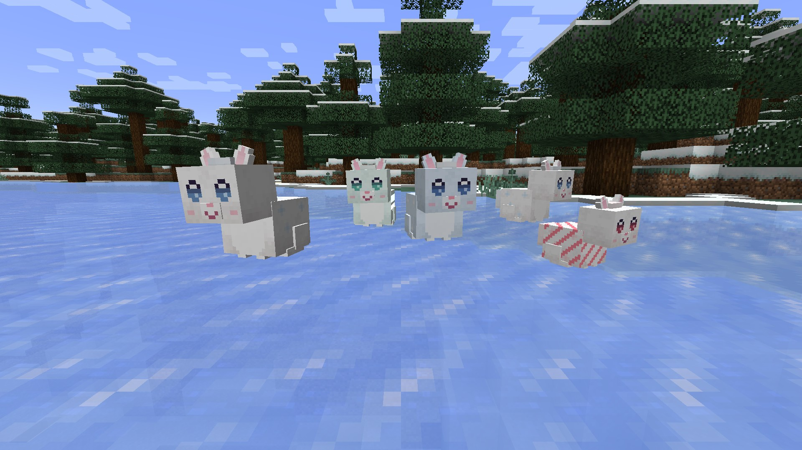

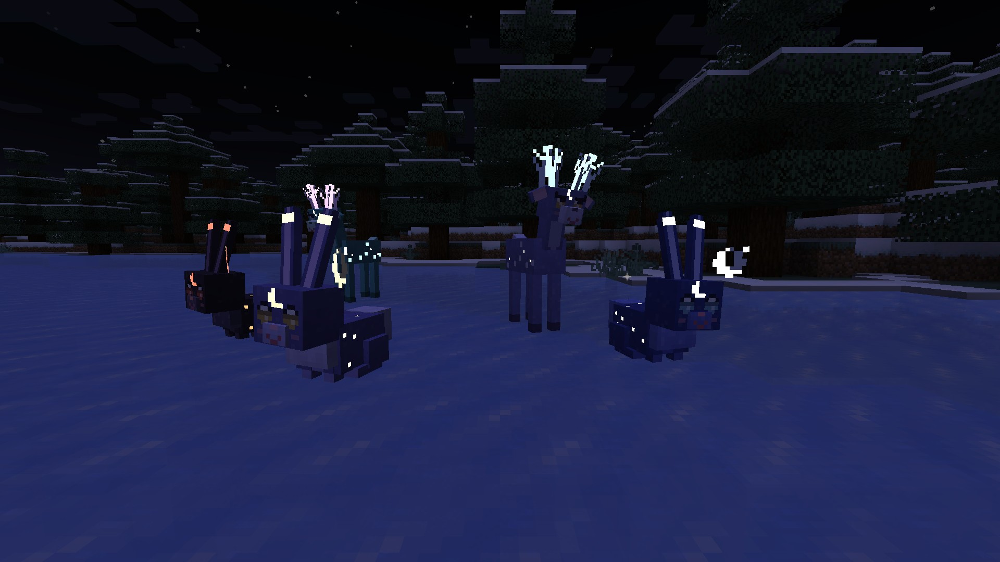

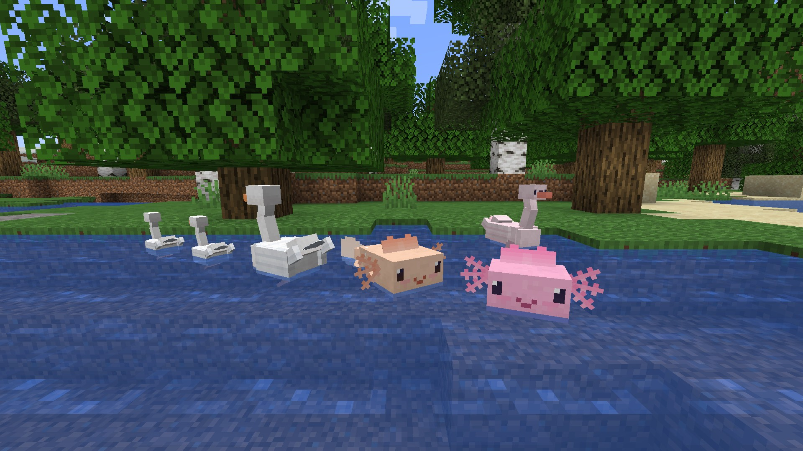

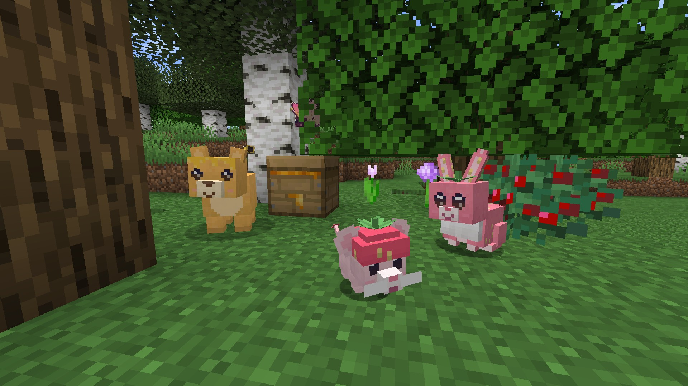

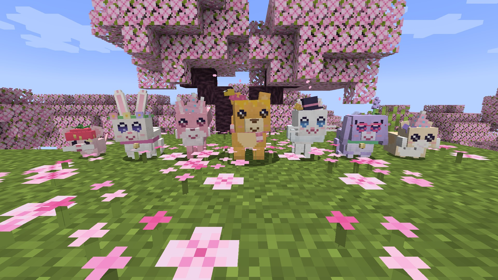

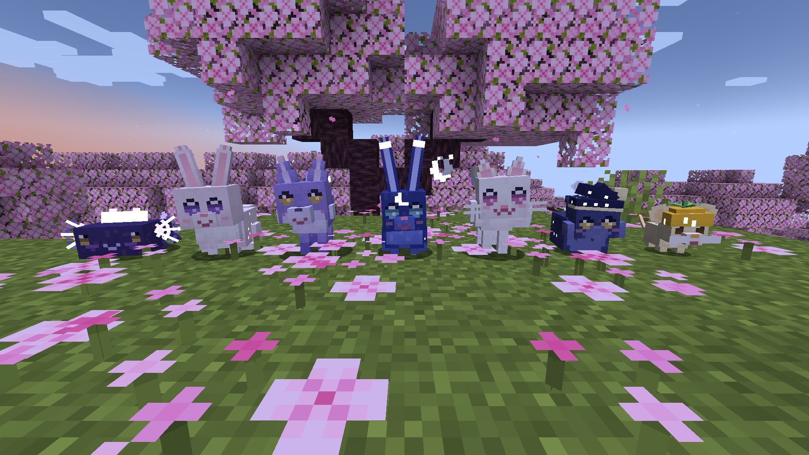

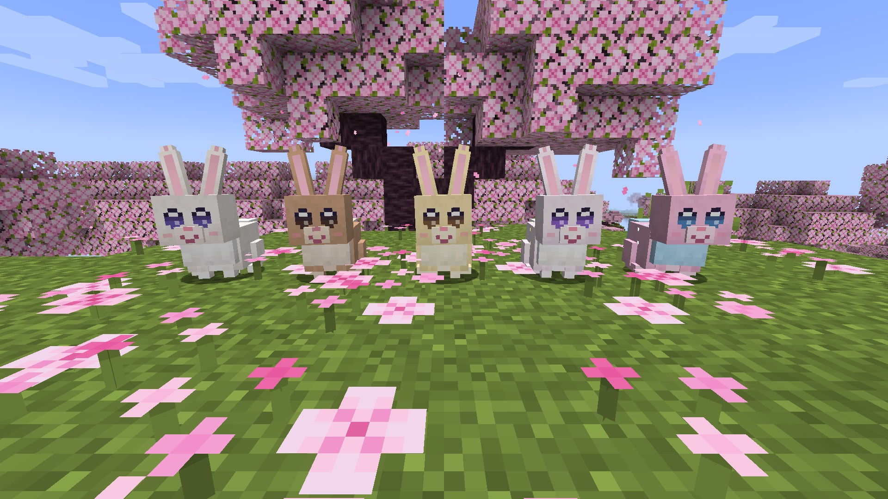

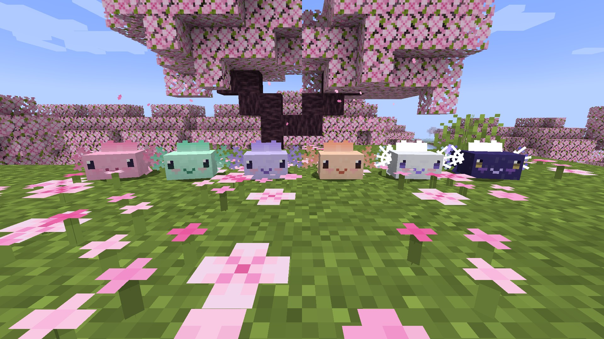

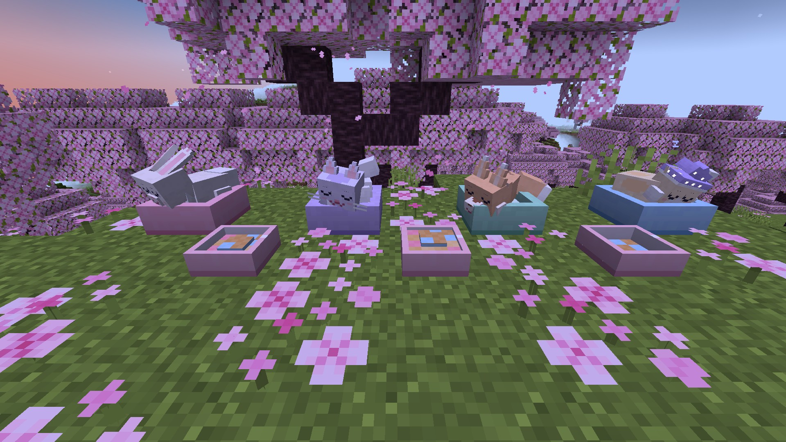

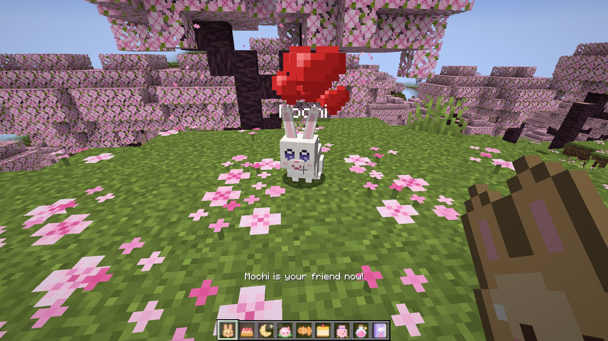

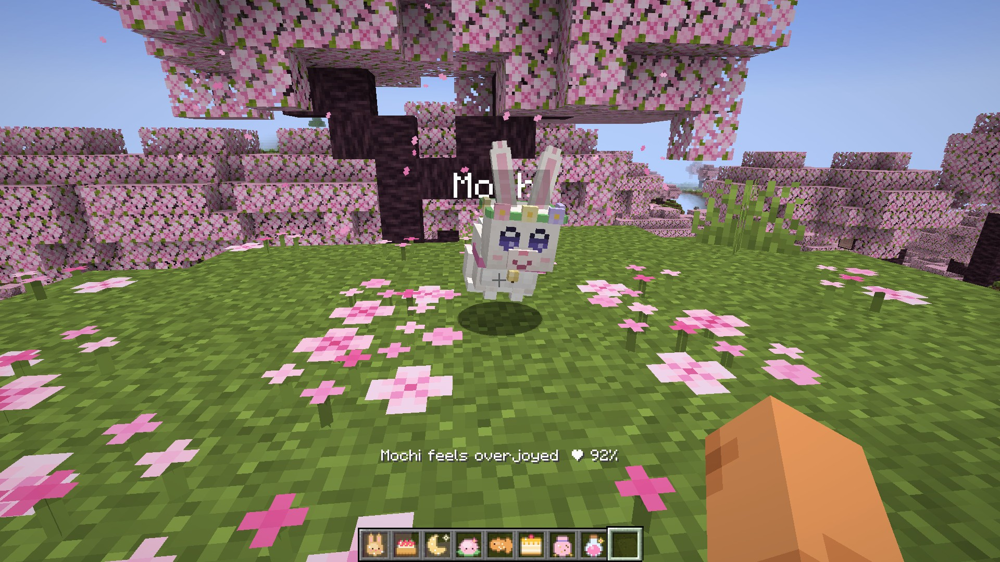

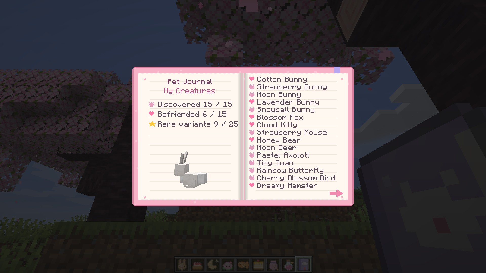

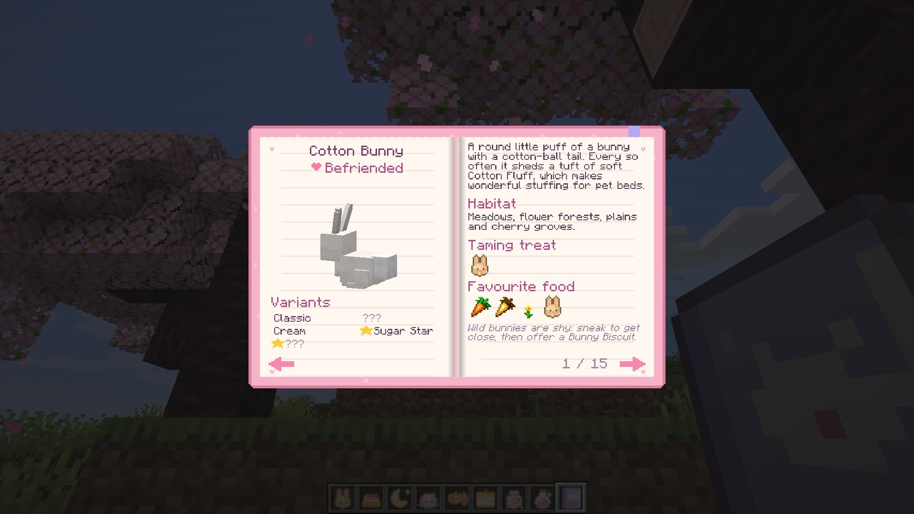

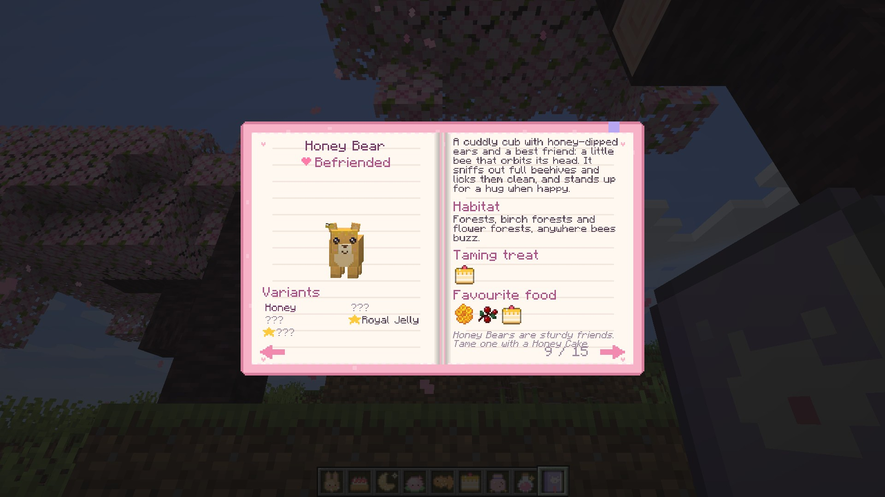

---

Bunnyland is made by Sugarplum Studios and animated with GeckoLib. All rights reserved. The Fredoka and Nunito fonts used in this artwork are licensed under the SIL Open Font License 1.1.
